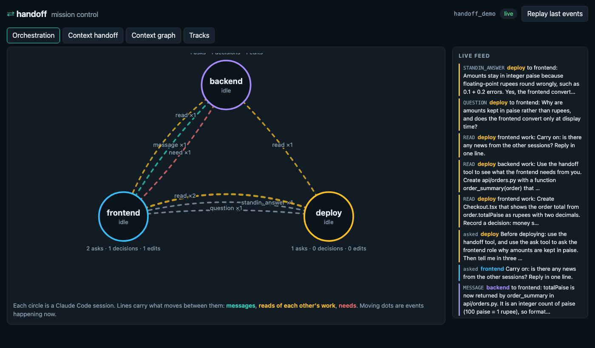
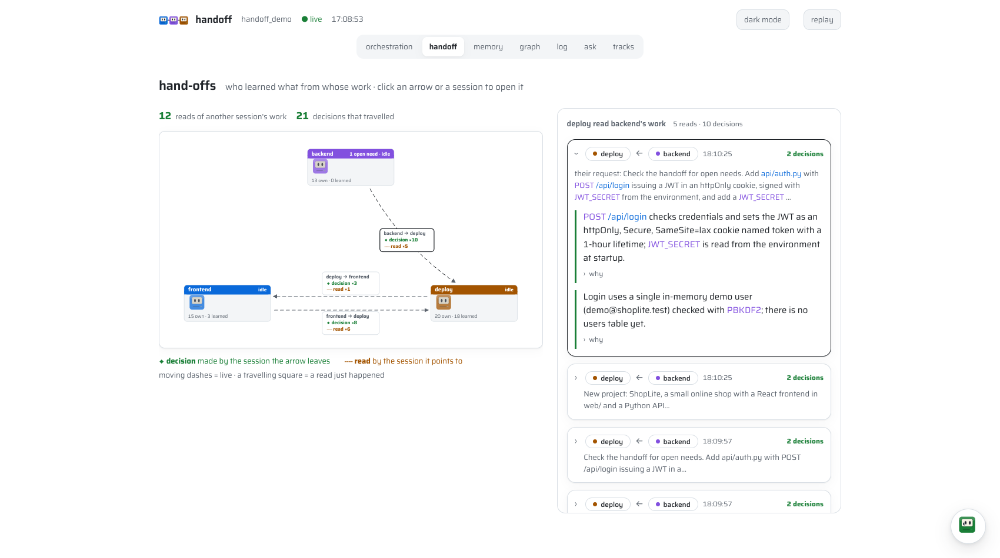
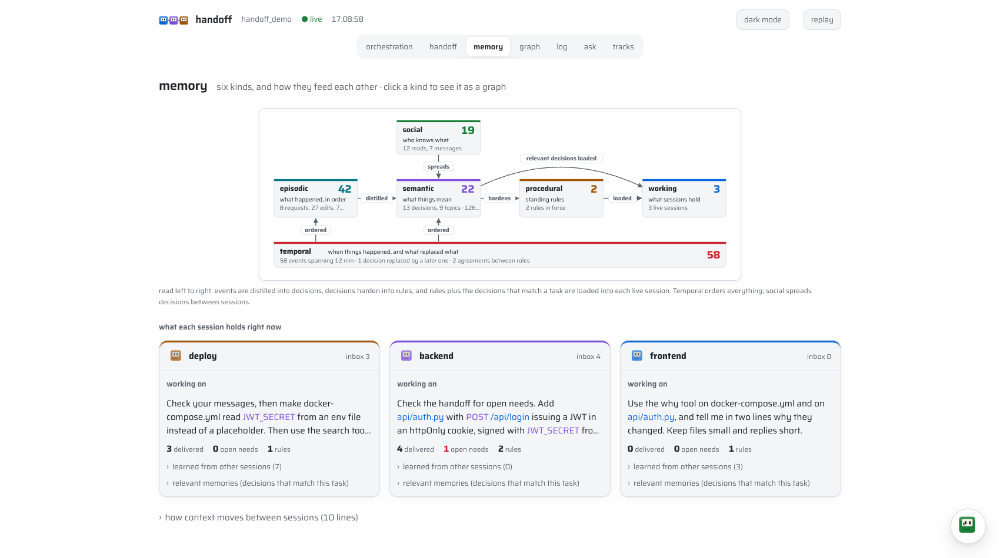
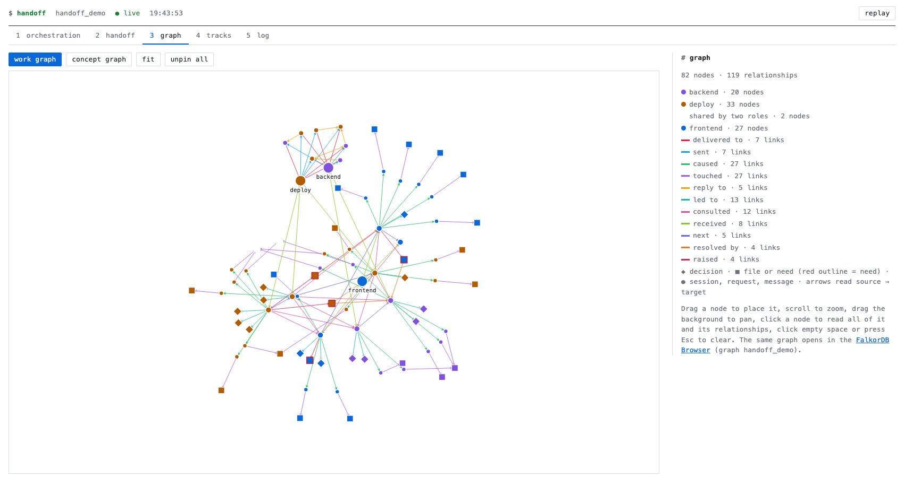
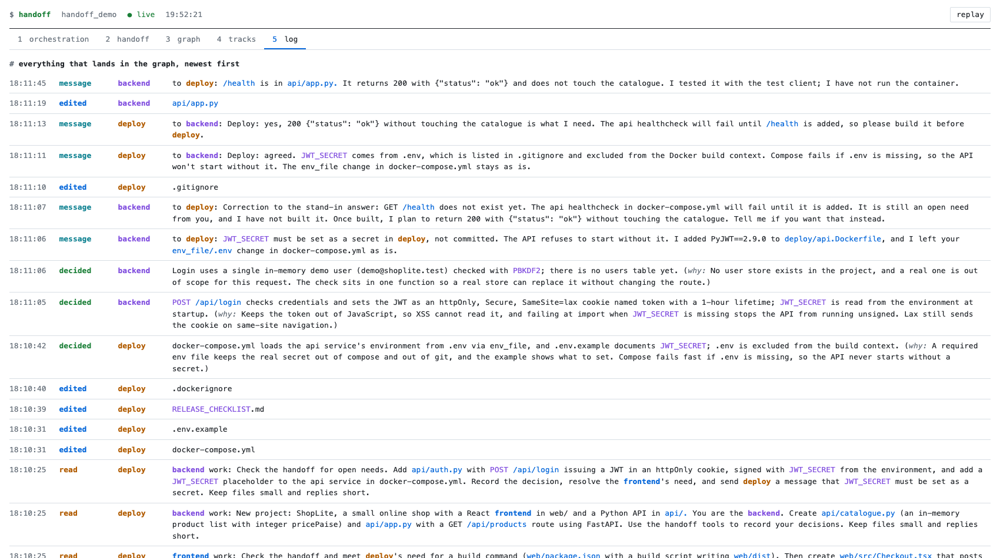
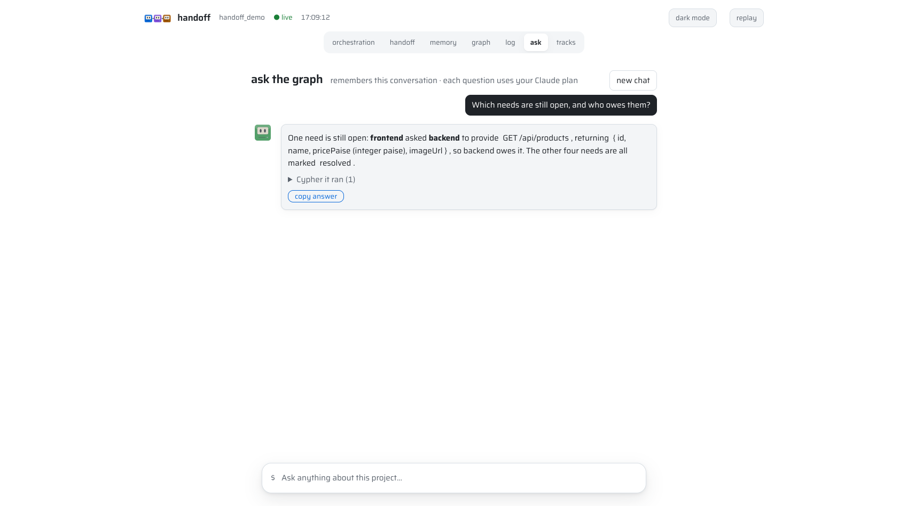
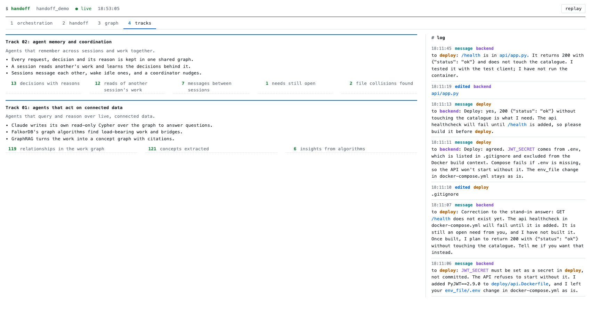
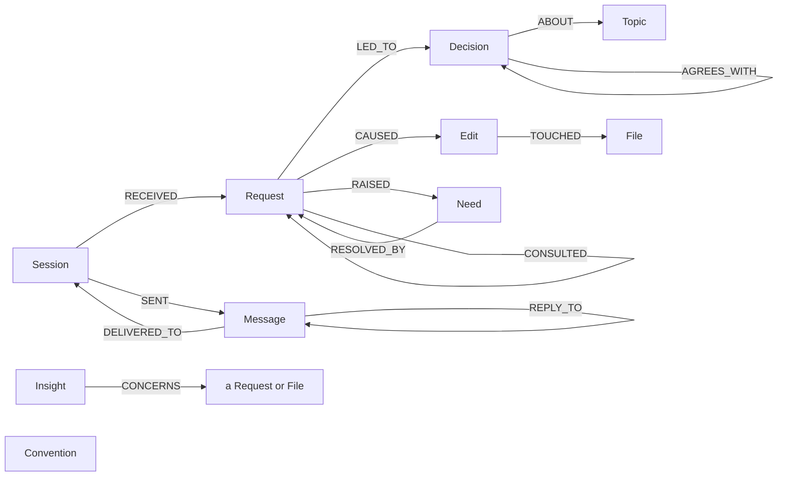

# handoff

**Parallel Claude Code sessions that know what each other are doing, and why.**

Open a frontend terminal, a backend terminal and a deploy terminal. Normally they cannot
talk: the backend session sees the frontend's diff but not what the person asked, what was
decided, or why. handoff puts all of that in one [FalkorDB](https://www.falkordb.com) graph
that every session reads and writes through hooks and MCP tools.

- **Intent, not diffs.** Each request, decision (with its reason), file edit and open need
  is recorded as it happens, and linked.
- **Sessions talk.** One session messages another; an idle one is woken. A question to an
  absent session gets a stand-in answer from that role's own history, with its sources.
- **Collisions and relays are visible.** Who changed the same file, who read whose work.
- **The graph is queryable by the sessions themselves.** `graph_guide` teaches Claude the
  graph, and it writes its own read-only Cypher.
- **FalkorDB's algorithms find what matters:** collisions, load-bearing work, bridges and
  themes.

**Demo video:** https://youtu.be/16bKhR6Q08c

Built for [Graph Hacks](https://www.wemakedevs.org/hackathons/falkordb) (WeMakeDevs ×
FalkorDB). Python 3.12+, MIT licence.

## Install

You need Docker (or Colima), [Claude Code](https://claude.com/claude-code) logged in, and
[uv](https://docs.astral.sh/uv/). Node 18+ is optional (FalkorDB's own MCP server).

```bash
uv tool install "handoff[knowledge] @ git+https://github.com/adityailab/graph-agent"
cd your-project
handoff init
```

`handoff init` shows the logo and a live checklist on a terminal (plain text in a pipe, with `NO_COLOR=1` or in CI), checks what is missing and says how to fix it, uses a FalkorDB that is
already running or starts one in Docker (localhost only, data in a volume), and installs the
hooks and MCP servers into the folder on a graph of its own. Then start one Claude Code per
role:

```bash
HANDOFF_ROLE=frontend claude
HANDOFF_ROLE=backend  claude
HANDOFF_ROLE=deploy   claude
```

No API key: everything runs on your Claude Code login. Drop `[knowledge]` to skip the
knowledge graph (it pulls a large dependency).

## See it work

```bash
handoff demo
```

opens a tmux grid of three real Claude Code sessions plus a live feed, and runs a
collaboration (a small shop, "ShopLite") round by round. Accept Claude Code's folder-trust
prompt in each pane and it starts by itself. Without tmux, or when output is not a
terminal, it runs headless instead; `handoff demo --headless` forces that, as plain text
ending in a PASS or what is missing. Both use your plan, on Haiku.

Open **http://localhost:3000** (FalkorDB Browser), pick the demo graph and run
`MATCH p=()-[]->() RETURN p`.

## Mission control

`handoff demo` (and `handoff dashboard` on any project) opens one browser window beside
the terminals. It reads the same graph the sessions write, every 1.5 seconds, and shows seven pages (number keys 1 to 7 switch between them; light and dark mode with the button in the header):

| | |
|---|---|
| **Orchestration**: a workflow of sessions drawn as small old-Macintosh agents with arrows for messages, reads and needs; click a session for its work |  |
| **Handoff**: a workflow graph of who read whose work, an arrow per reader and author with how many decisions travelled; click an arrow for the hand-off cards |  |
| **Memory**: the six kinds of memory with counts, and what each session holds right now: its task, what it learned from others, what reached it |  |
| **Graph**: the shared graph drawn with force-graph (drag, zoom, pan), links coloured and named by relationship, with cards for the selected node and its connections (a connect button walks the graph), and the concept graph and each kind of memory |  |
| **Log**: a swimlane on a shared time axis, one column per session; an empty cell means that session did nothing then |  |
| **Ask**: a chat with the graph in plain words; Claude Code writes the Cypher and shows it |  |
| **Tracks**: how handoff answers each competition track, with live numbers |  |

In the **Log**, events that happened together share a row and quiet stretches are marked; click an event for its full text. **Ask** is a chat with the graphs: every question goes to Claude Code, which writes read-only Cypher. The bot button (or `/`) opens the same chat in a right-hand panel on any page, using that page as context, and the conversation is kept on the Ask page (and in this browser, so a reload does not lose it; "new chat" clears it). The `$` field at the bottom of every page also takes `msg <session> …`, `need <session> …` and `go <page>`. The type is Saira throughout, served from your machine. Nothing leaves your machine: the page is served from `127.0.0.1` only.

## The commands

Full walkthrough: [docs/guide.md](docs/guide.md). How two sessions started at different times work together, with diagrams: [docs/how-it-works.md](docs/how-it-works.md).

| Command | What it does |
|---|---|
| `handoff` | A home screen: database and sessions at a glance, every command, and the next step |
| `handoff init` | Check prerequisites, make sure FalkorDB runs, install into this folder |
| `handoff status` | Database, graph, active sessions and what each is on, open needs |
| `handoff log [role]` | What each role asked, decided, changed and needs |
| `handoff send <role> "text"` | You message a role; an idle session wakes and acts |
| `handoff ask "question"` | Claude answers from the graphs, writing read-only Cypher; prints the query |
| `handoff insights` | Collisions, load-bearing work, bridges, themes |
| `handoff watch` | Live feed of the graph |
| `handoff memory` | The six kinds of memory with counts, and what each session holds (see [docs/memory.md](docs/memory.md)) |
| `handoff timeline <topic>` | How decisions on a topic changed, and what replaced what |
| `handoff conventions [add\|retire]` | Standing rules every session of a role is told once |
| `handoff open [dashboard\|graph\|guide]` | Open mission control, this project's graph in the FalkorDB Browser, or the guide |
| `handoff dashboard` | Mission control in your browser: sessions and their traffic, hand-offs, the graph, the tracks |
| `handoff coordinator` | Always-on agent: reminds a role about a need open 30 min, tells two roles who changed the same file or who each decided on one topic, sends you an hourly digest (`--once`, `--dry-run`) |
| `handoff knowledge` | Build the knowledge graph (concepts the work is about) |
| `handoff demo [--headless]` | The proof |
| `handoff doctor` | One line per check (hooks, MCP server, database, `claude`, `tmux`) with what to fix |
| `handoff completion zsh\|bash` | Tab completion: `eval "$(handoff completion zsh)"` |

A mistyped command gets a suggestion (`handoff stat` → "Did you mean 'status'?"). Output is coloured on a
terminal and plain in pipes; set `NO_COLOR=1` to turn colour off. `handoff --version` prints the version.

Inside a session the tools are: `handoff`, `why`, `sessions`, `record_decision`,
`record_need`, `resolve_need`, `send_message`, `ask`, `search`, `connection`, `ask_graph`,
`concepts`, `graph_guide`, `timeline`, `supersede_decision`, `record_convention`, `conventions`, `retire_convention`.

## How it works

```
 frontend ─┐  hooks record each prompt and edit        ┌─> other sessions (context on each prompt,
 backend  ─┼─ + MCP tools record decisions, needs ────>│    wake-ups when a message arrives)
 deploy   ─┘  and messages                  FalkorDB   ├─> handoff watch / insights / ask
                                            graph      └─> FalkorDB Browser
```

Graph (per project): `Session -RECEIVED-> Request -LED_TO-> Decision -ABOUT-> Topic`,
`Request -CAUSED-> Edit -TOUCHED-> File`, `Request -RAISED-> Need -RESOLVED_BY-> Request`,
`Session -SENT-> Message -DELIVERED_TO-> Session`, `Message -CITES-> …`,
`Request -CONSULTED-> Request`, `Insight -CONCERNS-> …`. A second graph `<name>_kg` holds
concepts extracted from the work by GraphRAG-SDK (entity types: Component, File, Function,
API, DataField, Service, Library, Setting, Concept). The types grow from the data: every 10
ingested items GraphRAG-SDK proposes kinds the text mentions that we lack (e.g. Pipeline, Job,
DatabaseTable); sound ones are added for future extraction, up to 20, and saved per graph.

### The graph, mapped



Nodes: `Session` (one per terminal), `Request` (a prompt), `Decision` (with its reason), `Need`,
`Edit`, `File`, `Message`, `Topic`, `Convention` (a standing rule) and `Insight` (a finding).
Every id is Claude Code's own (`session_id`, `prompt_id`, `tool_use_id`), so replayed events
never duplicate.

### Where the agent's decisions come from the graph

| The agent does | It asks the graph |
|---|---|
| Gets context on each prompt | Messages waiting for this role, open needs addressed to it, and who recently changed the file it is about to edit (`Message-[:DELIVERED_TO]->Session`, `Need {status:'open'}`, `Edit-[:TOUCHED]->File`) |
| Explains a file (`why`) | `File<-[:TOUCHED]-Edit<-[:CAUSED]-Request-[:LED_TO]->Decision`: the intent behind each edit |
| Answers for an absent session | The role's own `Request` and `Decision` history, with the sources it cites |
| Finds what matters now (`insights`) | `algo.WCC` (collisions), `algo.pageRank` (load-bearing work), `algo.labelPropagation` (themes), and a bridge pattern over `CONSULTED` |
| Answers a question (`ask`, dashboard chat) | Claude writes read-only Cypher after `graph_guide`; for example, who owes an open need: |

```cypher
MATCH (s:Session)-[:RECEIVED]->(r:Request)-[:RAISED]->(n:Need {status: 'open'})
RETURN s.role AS asked_by, n.for_role AS asked_of, n.text AS need
```

Take the database away and the sessions are blind to each other again: nothing is kept
anywhere else. The mission control pages are drawn from these same queries, every 1.5 seconds.

### FalkorDB features in use

| Feature | Used for |
|---|---|
| Vector index (384-d cosine) | Search decisions by meaning |
| Full-text index (fuzzy, prefix) | Typo-tolerant search of requests, decisions, needs, messages |
| Unique and range indexes | Idempotent writes on Claude Code's own ids |
| `algo.SPpaths` | The chain of work linking two roles |
| `algo.WCC`, `algo.pageRank`, `algo.labelPropagation` | Collisions, load-bearing work, themes |
| JavaScript UDF | `handoff.overlap`, file overlap between two requests, inside the database |
| `db.meta.stats`, `db.indexes` | Live schema for `graph_guide` |
| Official FalkorDB MCP server (strict read-only) | Agents' own Cypher |
| GraphRAG-SDK | Knowledge graph and provenance back to requests |
| FalkorDB Browser | Seeing it all |

## Models

By default every model job (stand-in answers, the knowledge graph, `handoff ask`) runs
Claude Code headless on your login. Set `HANDOFF_MODEL_NAME` to pick the model (`haiku`
is cheapest). Alternatives for the stand-in and knowledge jobs:

- `HANDOFF_MODEL=anthropic` with `ANTHROPIC_API_KEY` (and `ANTHROPIC_WORKSPACE_ID` if the
  key is not scoped to a workspace).
- `HANDOFF_MODEL=ollama` with a local model, e.g. `HANDOFF_MODEL_NAME=qwen2.5:7b`.
  Small local models answer from the graph but may not cite their sources.

## Privacy and safety

- FalkorDB is bound to 127.0.0.1 and holds your prompts: no password, so keep it local.
- Prompts and diffs pass through a redactor (API keys, tokens, private keys) before storage.
- Hooks fail open: if handoff breaks, your session is never blocked; events are saved and
  replayed.
- Cypher written by a model only runs through FalkorDB's server in strict read-only mode.
- `handoff demo --workspace` only resets a folder the demo made.

## Development

```bash
uv sync --extra knowledge
make db-up      # FalkorDB for the tests
make check      # format, lint, mypy --strict, tests
```

User guide: [`docs/guide.md`](docs/guide.md). Design, plan and decision log: `docs/superpowers/`.

The graph view uses [force-graph](https://github.com/vasturiano/force-graph) (MIT, vendored in
`src/handoff/dashboard/static/`), the same library the FalkorDB browser draws with.
