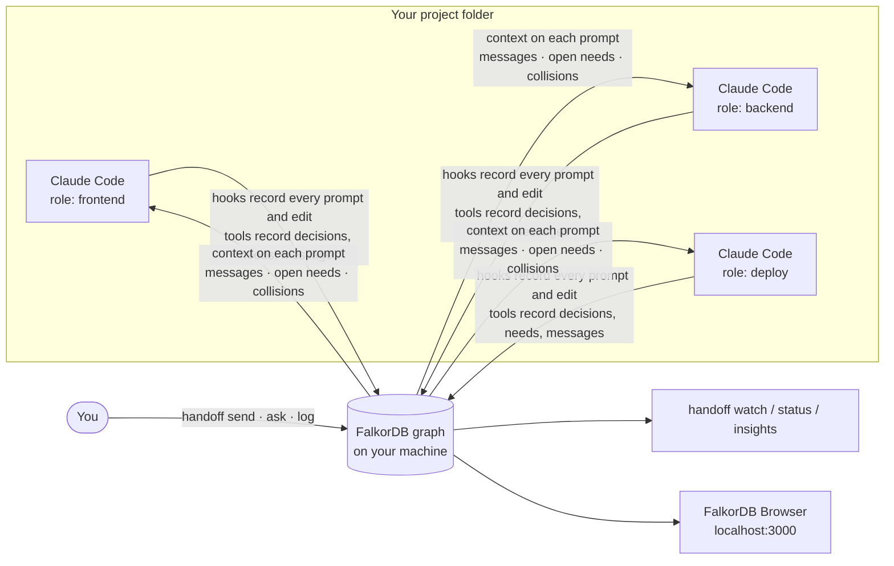
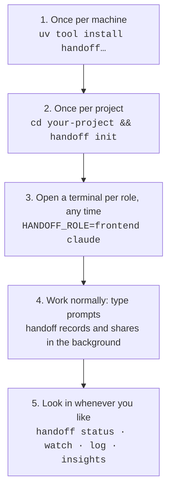
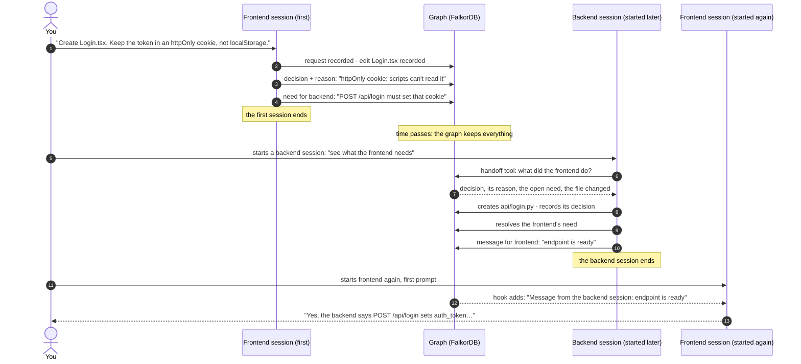
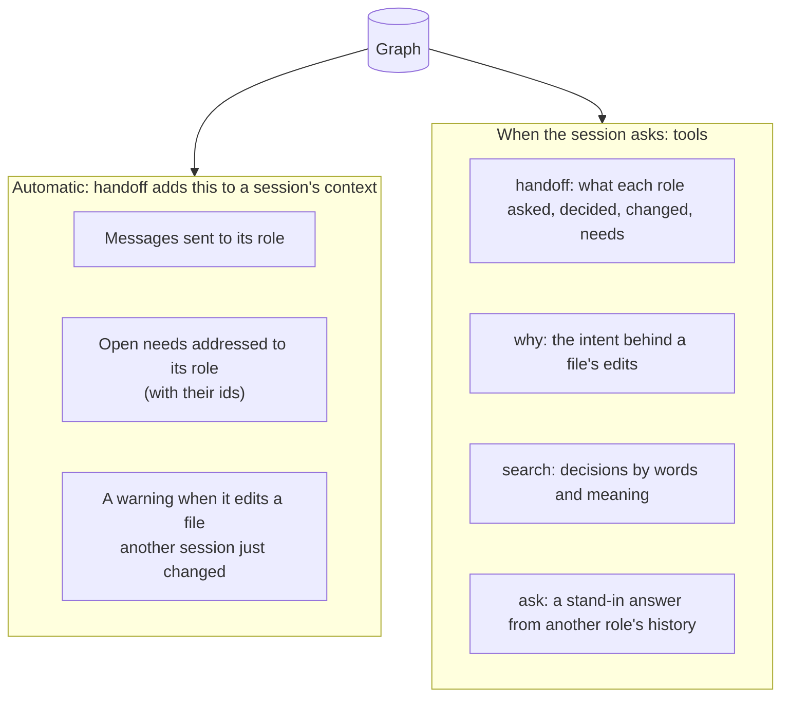
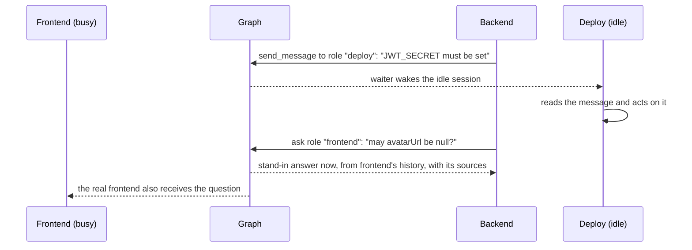
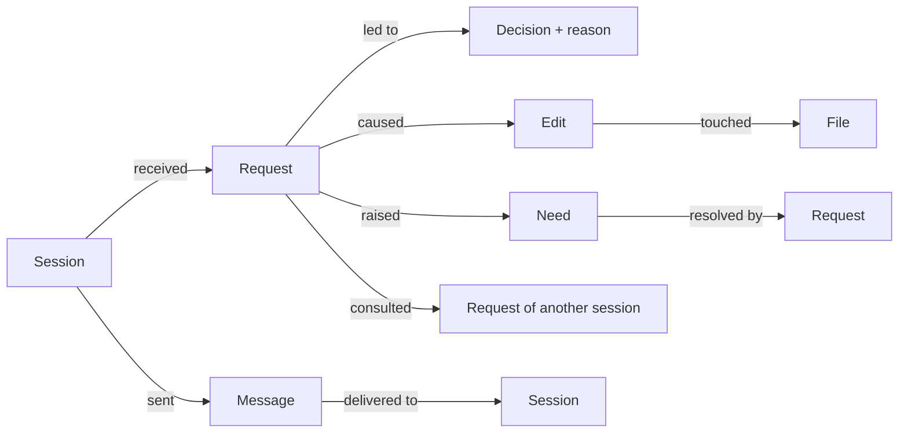

# How handoff works, with diagrams

This page answers two questions: *"I start a session in my project: what happens?"* and
*"I start a second session later: how do the two work together?"* The examples are from a
real run (three separate Claude Code sessions, captured on 17 October 2026).

## The idea in one picture

Sessions never talk to each other directly. They all read and write **one shared graph** that
lives on your machine, so they do not need to be running at the same time.

## Using it in your own project

`handoff init` installs hooks and two MCP servers into the project folder and starts FalkorDB
if it is not running. After that you do not run anything for handoff to work: you just start
Claude Code with a role. The first time, Claude Code asks you to approve the project's MCP
servers.

## Starting a second session later

This is the case that matters most. The first session does not have to be running when the
second one starts, because everything it did is already in the graph.

What the sessions actually said in that run:

**Backend (started later), asked to look at the frontend's work:**

> **What the frontend decided:** store the auth token in an httpOnly cookie, not localStorage.
> **Why:** page scripts can't read httpOnly cookies, so an XSS bug can't steal the token.
> **What it needs from you:** `POST /api/login` must set that cookie in the `Set-Cookie` header.

The backend never saw the frontend's conversation. It got the decision, the reason and the
need from the graph, then built the endpoint to match, resolved the need and messaged back.

**Frontend (started again), first prompt, with no tools used:**

> Yes. The backend session sent a message: "Backend endpoint is ready: POST /api/login
> (api/login.py) sets the token as an httpOnly, Secure, SameSite=Lax cookie named auth_token…"

That message was added to the session's context by a hook as the prompt was submitted.

## What a session learns, and how

- **Automatic** items arrive on every prompt without anyone asking.
- **On request** items are Claude Code tools. handoff tells each session they exist, so you
  can simply say "check what the frontend did" or "ask the backend why tokens rotate".

## When both sessions run at the same time

An **idle** session is woken when a message arrives (as long as it ended normally and its
waiter is still running). A **busy** session sees the message on its next tool call. Asking a
role that is not running gets an immediate **stand-in** answer written from that role's
recorded history, labelled as such, with the decisions and requests it relied on.

## What gets recorded

Every arrow is a relationship in FalkorDB, so questions like "which request caused this
edit?" or "who read whose work?" are graph queries. See them in the FalkorDB Browser at
http://localhost:3000, or run `handoff ask "…"`.

## Common questions

**Do I have to start the sessions in a particular order?** No. Start any role at any time.

**What if the first session is closed when I start the second?** Nothing is lost. The graph
holds its requests, decisions, needs and messages. The second session reads them with the
`handoff` tool.

**What if I start the second session before the first has done anything?** It sees an empty
graph and works on its own. As soon as the first session records something, it shows up.

**What if I restart the same role?** It is a new session with the same role. Messages sent
to that role while it was away are delivered on its first prompt.

**Two terminals, same role?** They share one identity, so give each terminal its own
`HANDOFF_ROLE`.

**Does Claude record decisions by itself?** Claude Code is told to use `record_decision` for
choices and `record_need` for what it needs from others. If a session changes files and
finishes without recording a decision, it is asked once to do so.

**Does anything leave my machine?** The graph and FalkorDB stay on your machine. Model calls
(stand-in answers, the knowledge graph) go through your Claude Code login like any other
Claude Code use.

More: [user guide](guide.md) for every command, [README](../README.md) for the overview.
